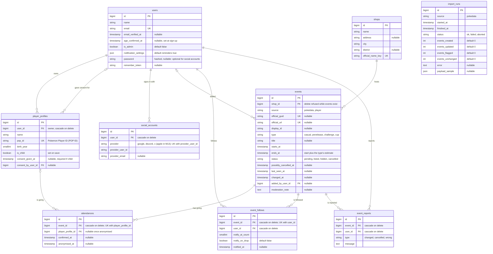

# Architecture

## Stack

| Layer | Choice | Notes |
| --- | --- | --- |
| Framework | Laravel 13, PHP 8.4 | Laravel 14 expected Q1 2027 and needs PHP 8.4, so no PHP upgrade then |
| Database | MySQL 8.4 LTS | Tests run on MySQL too (a `tournament_preflight_test` database), not SQLite, so JSON and date behaviour match production |
| Frontend | Official React starter kit: Inertia, React 19, TypeScript, Tailwind 4, shadcn/ui | Check the installed Inertia version on day one and record it in `decisions.md` |
| Routes in TS | Whatever the starter kit ships (Wayfinder or Ziggy) | Don't add a second one |
| Auth | Starter kit auth (Fortify): login, registration, email verification, password reset; Socialite for Google and X; Socialite Providers for Discord (M06) and Apple (M13) | No two-factor auth, no passkeys, no magic link |
| Background | Scheduler + queues on the database driver | One `queue:work` process in production |
| Mail | Laravel Mail, Markdown mailables; Mailpit locally | Provider is an open decision |
| Tests | Pest 5 (+ browser plugin), Larastan level 7, Pint; Vite+ `vp check` for TS/React lint and format; Vitest (bundled in Vite+, `npm run test`) for pure JS logic and component markup, files `resources/js/**/*.test.ts(x)` | See `workflow.md` |
| Dev help | Laravel Boost (MCP server with version-specific docs, schema, tinker) | Optional but recommended |

## Code layout

Laravel defaults first, plus Actions and Services. KISS: no domain or module folders, no repositories, no interface until there are two implementations. Anything outside this layout needs Bruno's approval and a line in `decisions.md`.

```
app/
  Http/Controllers/Public, /Account (the signed-in account's own data: PlayerProfileController), /Admin,
                      /Auth (sign-in our code adds beside Fortify: social, pending intent)
  Http/Requests/      Form Requests: HomeFilterRequest, StorePlayerProfileRequest
                      thin: a Form Request validates, a Policy authorizes, one Action does the work,
                      the controller returns Inertia with Data objects
  Actions/            one class per operation that changes state, one public `handle()` method; called from
                      controllers, jobs and commands: SignInWithSocialAccount, CreateUserFromSocialIdentity, RevokeUnprovenAccess, SetAttendance, CreatePlayerProfile, ApproveSubmission, SyncEvents
  Services/           talks to the outside world, or logic several Actions reuse, with no state of its own:
                      PokedataClient
  Data/Public/        the ONLY shapes sent to other players: EventCardData, EventPageData, EventCountsData
  Data/Private/       shapes sent only to the account that owns the data (never to other players):
                      OwnProfileData, OwnAttendanceData
  Data/Import/        ImportedEvent, SyncReport
  Enums/              EventType, EventStatus, EventSourceKey, SocialProvider
  Notifications/      StillGoingNotification, ThresholdReached, PossiblyCancelled, SubmissionReviewed
  Models/ Policies/ Jobs/ Console/Commands/   Laravel defaults
resources/js/
  pages/              Inertia pages: home, events/show, profiles/*, admin/*
  layouts/            public-layout.tsx (band, optional hero, footer) plus the kit's layouts
  components/         the starter kit's own components (app-header, app-sidebar, nav-*, ...), left as the kit ships them
  components/pf/      our components, kebab-case files like the kit, each with its test beside it: app-logo,
                      app-logo-icon, tournament-type-icon, tournament-type-badge, responsive-dialog; later
                      pairings-sheet, event-list-item, going-button, profile-picker, filter-bar
  components/ui/      shadcn/ui files we own and restyle with the tokens (button, card, dialog, drawer, empty, sonner, ...)
  lib/time.ts         all date formatting, Europe/Lisbon, en-GB style
  lib/tournament-types.ts  tournament types (common to rare) and their display names
tests/
  Feature/  Unit/  Browser/  Arch/  Fixtures/pokedata/
```

## Data model

All timestamps UTC. `id` bigint, `timestamps()` on every table unless noted.

### Diagram

Kept in step with the migrations (CLAUDE.md, "Database diagram"). `created_at`/`updated_at` are left out of each box. Framework and starter-kit tables (sessions, cache, jobs, failed_jobs, password_reset_tokens) are not shown. GitHub renders the diagram; elsewhere paste it into mermaid.live.



How to read the lines: `||--o{` is "one to many" (a user owns zero or more profiles); `|o--o{` is "zero or one to many" (an attendance has a profile until it is anonymised, then none).

**users** (a login): name, email (unique), email_verified_at, is_admin (bool, default false), age_confirmed_at (nullable; set when the person ticks "I am 13 or older" at sign-up; accounts made before M06 have none), notification_settings (json, `{"reminders": true}` by default; a JSON object so more settings can be added later), password (hashed; nullable: a social account needs none and may add one in Settings → Security), remember_token. No two-factor columns (dropped in M06).

**social_accounts**: user_id, provider (google, discord, x; apple in M13; cast to the `SocialProvider` enum), provider_user_id, provider_email (nullable). Unique (provider, provider_user_id).

**player_profiles**: user_id (owner), name, pop_id (the Pokemon Player ID, or POP ID, shown as "Pokemon Player ID"; string of digits, unique), birth_year (smallint), is_child (bool, computed on every model save: current Lisbon year minus birth year is 13 or less), consent_given_at (nullable, required when is_child), consent_by_user_id (nullable). Soft deletes: no; deletion cascades to attendances.

**shops** (a host shop; not a shop account): name, address (nullable), city, district (nullable), official_name_key (normalized name + city, for matching imported events). Unique (official_name_key). Name + city is not reliable for pokedata (spellings vary, `docs/pokedata.md`); the pokedata `league` ID is the candidate key, decided in M10.

**events**: shop_id, source (pokedata, player), official_guid (nullable, unique; pokedata's `guid`), official_url (nullable, unique), display_id (official tournament ID, nullable), type (casual, prerelease, challenge, cup), title (nullable), starts_at, ends_at (always the type's estimate from `EventType::estimatedHours()`; written by the model's `saving` hook, recomputed whenever starts_at or type changes), status (pending, listed, hidden, cancelled), possibly_cancelled_at (nullable), last_seen_at (nullable, set by sync), changed_at (nullable, last significant change), added_by_user_id (nullable), moderation_note (nullable). Index (status, ends_at, starts_at).

**attendances**: event_id, player_profile_id, confirmed_at (nullable), anonymised_at (nullable). No status column: a row means the profile is going; not going means no row, so removing an answer deletes the row. Unique (event_id, player_profile_id), which also serves lookups by event. After anonymisation player_profile_id becomes null and the unique key no longer applies (MySQL allows several NULLs).

**event_follows**: event_id, user_id, notify_at_count, notify_on_drop (bool), notified_at (nullable). Unique (event_id, user_id).

**event_reports**: event_id, user_id, type (changed, cancelled, wrong), message. For "Report a change".

**import_runs**: source, started_at, finished_at, status (ok, failed, aborted), events_created, events_updated, events_flagged, events_unchanged (ints, default 0), error (text, nullable), payload_sample (json, nullable).

Plus the framework tables: sessions, jobs, failed_jobs, cache, notifications (not needed unless database notifications are used).

### Counts

Computed with `withCount` on attendances. No denormalised counter in v1. If the home page query gets slow, add a cached counts table later, written by the `SetAttendance` action.

## Privacy enforcement (rule 1 in CLAUDE.md)

- Public controllers return only `app/Data/Public` objects. These classes have no name, Pokemon Player ID (POP ID) or birth-year fields by construction.
- Arch tests (`tests/Arch/ArchTest.php`): public controllers and the `app/Data/Public` classes never use `User` or `PlayerProfile`, and those classes are final and readonly. They do not stop a raw model such as `Event` being sent as a prop; the feature test below checks what pages actually send.
- `tests/Feature/Privacy/NoPersonalDataLeaksTest.php` seeds an adult and a child profile named like `Zzleak Name 4711` with Pokemon Player IDs (POP IDs) `9988776655`/`9988776656` and birth year 1913, visits every route in a dataset as guest and as another user, and asserts no name or ID appears in the HTML (in any letter case) and the birth year not in the Inertia props. A second dataset covers the sign-in pages (login, register, forgot password, welcome, verify email, first profile), each opened by the viewer who can reach it, because they share the same Inertia props. Each new public route is added to a dataset in the same PR.
- Logs never contain profile names or Pokemon Player IDs (POP IDs).

## Time

`APP_TIMEZONE=UTC` (read by `config/app.php`; never change it per environment). Database in UTC. Imported local times are parsed as `Europe/Lisbon` then converted (no island events on 18 Nov 2026; Madeira shares Lisbon time but the Azores are an hour behind, so check the first Azores events before trusting them: warning in `docs/pokedata.md`, no special handling until then). The frontend formats every date through `resources/js/lib/time.ts` with `timeZone: 'Europe/Lisbon'` and `en-GB` style ("Sat 15 Nov, 10:00"). Date filter presets are computed in Lisbon time on the server.

## Event import

There is one source, so there is no source interface (KISS; add one only when a second source exists). Player-submitted events do not go through the import.

`PokedataClient` (service) has one public method, `upcoming(): list<ImportedEvent>`. It uses Laravel's HTTP client with `->throw()`, so a failed request raises an exception, and maps the real response (fields recorded in the M03 spike in `docs/pokedata.md`) to `ImportedEvent`. It requests `_tcg/_country/PT` and keeps only `nonpremier TCG`, or `League Challenge`/`League Cup` with `product: tcg` (a bare `_tcg` also returns VG and GO events; filter contract in `docs/pokedata.md`); every other type is dropped, so prereleases join the filter once their pokedata `type` is known. Tests use `Http::fake()` with the fixtures.

`ImportedEvent` is a plain readonly object: guid, officialUrl (nullable), displayId (nullable), type, title (nullable), startsAt (UTC CarbonImmutable), shopName, shopAddress, city, leagueId. No end time: pokedata has none.

`SyncEvents` (action), run by `php artisan events:sync {--dry-run}` and scheduled nightly at 03:30 Lisbon:

1. Fetch. On exception, an empty result, or a result less than half the size of the last good run, abort: change nothing, record the run as aborted, notify admins.
2. For each imported event, find an existing one by official_guid, then official_url. Not found: create as `listed`. Found and unchanged: touch `last_seen_at`. Found and changed in starts_at or shop: update (recomputing ends_at from the type's estimate), set `changed_at`, clear `confirmed_at` on its going answers, dispatch `StillGoingNotification` (reason: changed) to the accounts concerned. Other field changes (title, display ID) update silently.
3. Each listed, upcoming event from this source not seen tonight gets `possibly_cancelled_at` (once) and a `PossiblyCancelled` notification. If it reappears later, the flag is cleared.
4. Write the `import_runs` row with the counts.

Safe to run twice: a second run finds everything unchanged. The first fill of an empty database is just the first run.

Player-submitted events go through the same matching (Guid, then URL) before they are saved.

## Notifications

Laravel Notifications on the `mail` channel, queued. Signed URLs (`URL::temporarySignedRoute`, valid until the event ends) for Yes/No answers in emails so no login is needed. Schedules (Lisbon time): `reminders:day-before` at 18:00 for events starting the next day; `thresholds:check` runs after every `SetAttendance` (dispatched job), not on a schedule; `attendances:anonymise` daily. Reminders respect `notification_settings.reminders` and carry a signed one-click unsubscribe. "Event changed" and "possibly cancelled" are always sent. Threshold emails stop by unfollowing; moderation emails are a one-off reply to the submitter.

## Auth flows

- Email and password: Fortify login (rate limited), registration with the "I am 13 or older" box, email verification, password reset.
- Social: generic routes `/auth/{provider}/redirect` and `/auth/{provider}/callback`, restricted with `whereIn` to the enabled providers (google, discord, x; apple in M13). One shared class does the work for every driver. Match by (provider, provider_user_id); if none, match an existing user by email and link, **only when the provider says the email is verified**; else, when the provider certifies for the email, send the person to the welcome page (name, the provider's email read-only, the age box) and create the account there, already verified. The pending sign-up waits in the session for 10 minutes at most; the welcome POST is throttled (6 a minute). An identity whose provider does not vouch for an email (X without one, Discord or Google unverified) never gets an account: back to sign-in with "Your X account has no confirmed email. Sign in another way, or register with your email and a password." So a social login only ever sits on a proven email. Social accounts start without a password and need none: the provider proved the email, and one email is one account. They may add one in Settings → Security: the page skips Laravel's password confirmation when there is no password (`ConfirmPasswordIfSet`, a subclass of `RequirePassword`) and offers "Email me a link to set a password", which sends Laravel's reset email and signs the player out, because Fortify's reset page opens only signed out. "Forgot password" works the same way. Apple sends name only on first login; store it then.
- **Player gate** (middleware): anyone, signed in or not, may look at every page; only a player answers: a verified email and a player profile (its Pokemon Player ID (POP ID) is required); a password is optional. The gate steps in only on the way to answering, when the session holds a pending "I'm going": a user who is not ready is redirected to the verify notice, then to "Create your player profile" (`redirect()->guest()` keeps the page). Auth pages, settings, logout, `events.going` and `profiles.*` stay open. It decides by route name, so every route it leaves open has one (the kit's `/settings` redirect is named `settings`). Guests are not affected.
- **Pending intent**: when anyone presses "I'm going" (a form that POSTs to `events/{event}/going`, CSRF-protected; a GET is refused, so a link cannot answer for someone), store `{event_id}` in the session (never in the URL), keep the page as Laravel's intended URL (`return_to`, our host only) and send a guest to sign in; a signed-in user goes straight back to the page. On the profile page, "Not now" (`DELETE events/going`, `events.going.forget`) forgets the intent and returns to the saved page, so a pending intent never holds anyone there. The player gate saves the page it blocks the same way (`redirect()->guest()`, like the `auth` middleware), so verifying the email (Fortify calls `intended()`) and saving the first profile (M07) return there. Only upcoming events (listed, not ended) are accepted; any other gets a 404. After sign-in and the gate, they return to that page and it receives the intent once as a prop. M08 acts on it: one profile applies it, several open the picker.

## Admin

Simple Inertia pages behind `can:admin` (Gate on `is_admin`): pending submissions (approve, edit, reject with note), events (search, hide, unhide, mark cancelled), reports, import runs. No admin package.

## Environments and CI

- Local: Laravel Herd (PHP), DBngin (MySQL 8.4), Mailpit.
- CI: GitHub Actions with a MySQL 8.4 service runs `composer verify` on every push and PR.
- Production: hosting is an open decision. Needs PHP 8.4, MySQL 8.4, a cron for the scheduler, one queue worker, HTTPS.

## Security basics

CSRF on (Inertia default), rate limits on login, answer and submission routes, policies on every Account and Admin controller (`$this->authorize`), signed routes for email actions, `Http::preventStrayRequests()` in tests, secrets only in `.env`.
